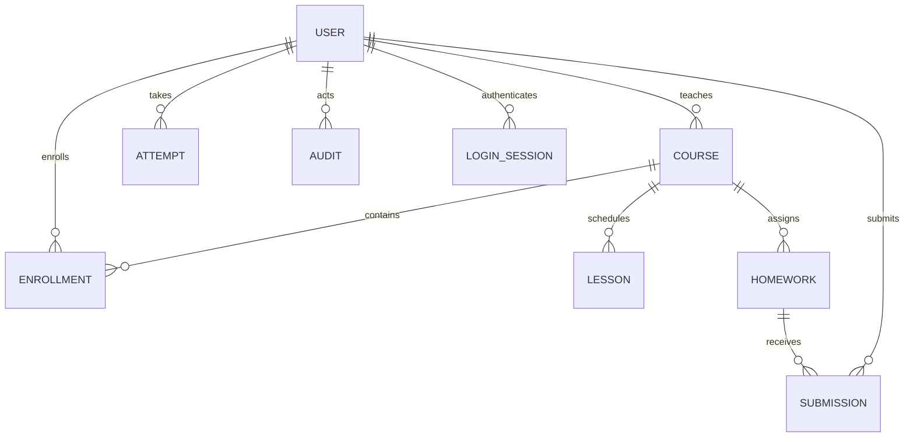

# Архитектура и требования

Цель — автоматизировать тестирование уровня, занятия и домашние работы школы иностранных языков, обеспечив доступ к авторским материалам только участникам курса.

Браузер → Flask (валидация, CSRF, аутентификация и авторизация) → SQLAlchemy → PostgreSQL. HTML формируется Jinja с автоматическим экранированием. Аналитика получает обезличенный CSV попыток. Пользовательские ответы не исполняются и не становятся частью SQL.

## Матрица доступа

| Действие | Гость | Ученик | Преподаватель | Администратор |
|---|---|---|---|---|
| Каталог и регистрация | Да | Да | Да | Да |
| Тест и свои результаты | Нет | Да | Нет | Нет |
| Материалы и расписание | Нет | Записанные курсы | Свои курсы | Все |
| Сдача работы | Нет | Своя работа | Нет | Нет |
| Просмотр работ | Нет | Только своя | Свои курсы | Все |
| Оценивание | Нет | Нет | Свои курсы | Все |
| Курсы, занятия, задания | Нет | Нет | Свои курсы | Все |
| Запись ученика и роли | Нет | Нет | Нет | Да |
| Журнал и экспорт | Нет | Нет | Нет | Да |

## ER-диаграмма

Модель группы в этой учебной реализации совмещена с курсом: отдельный поток обучения создаётся отдельным курсом. Пользователь и курс связаны через уникальную пару Enrollment. Преподаватель хранится в Course.teacher_id. Подмена URL не меняет принадлежность объекта. Homework наследует доступ от Course; Submission — от Homework. Уникальная пара homework_id/user_id запрещает дубли работ. Ограничения CHECK задают роли, диапазоны оценки и результата теста. Сроки и идентификаторы проверяются сервером. Каскадное удаление учебной истории не выполняется: удалить можно только пустой курс.

## Персональные данные

| Поле | Хранение | Обоснование |
|---|---|---|
| password_hash | Argon2id, случайная соль | Необратимая проверка пароля |
| phone_cipher | Fernet | Расшифровка возможна только с FIELD_KEY |
| name | Открытый текст в защищённой БД | Отображение в кабинете |
| email | Открытый текст, UNIQUE | Поиск учётной записи |
| sid | Случайный токен в серверной таблице | Отзыв и срок действия сессии |

## Модель угроз

| Угроза | Мера | Проверка |
|---|---|---|
| SQL-инъекция | ORM с привязанными значениями, отсутствие динамического SQL | Инъекция в логин и ответ теста |
| Несанкционированное чтение курса | Проверка Enrollment или teacher_id на сервере | Второй ученик и чужой преподаватель получают 403 |
| Повышение роли | Роль регистрации задана сервером | role=admin не меняет роль ученика |
| XSS | Экранирование Jinja, CSP без inline-скриптов | script показывается текстом |
| CSRF | CSRFProtect и токен всех изменяющих форм | POST без токена возвращает 400 |
| Повторное использование вышедшей сессии | Серверный отзыв sid | После logout сессия удалена |
| Перебор паролей | Argon2id и глобальный лимит | После 30 ошибок в минуту — 429 |
| Утечка телефона из БД | Fernet, ключ вне БД | В таблице нет исходного номера |

Границы защиты: авторизованный ученик способен скопировать текст. Система предотвращает чужой доступ, но не обещает DRM. Глобальный лимит может быть использован для отказа в обслуживании; в промышленной версии нужны более точные ограничения. Компрометация сервера с доступом к .env выходит за пределы шифрования полей.
